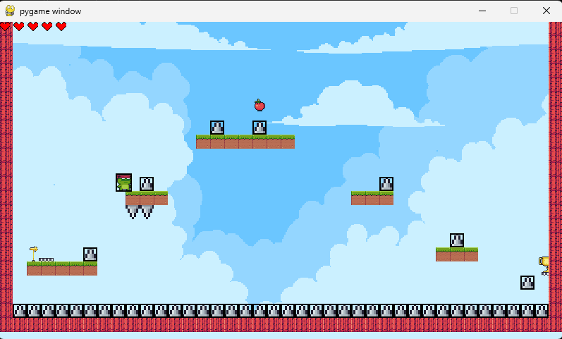
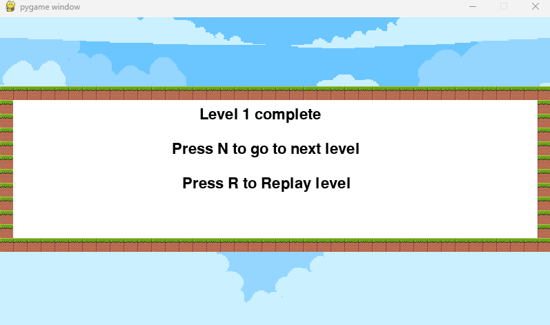
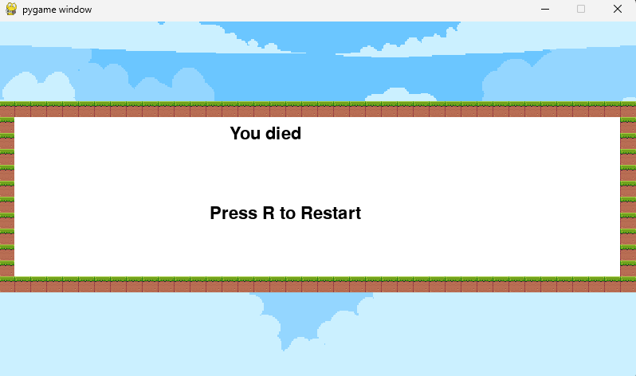
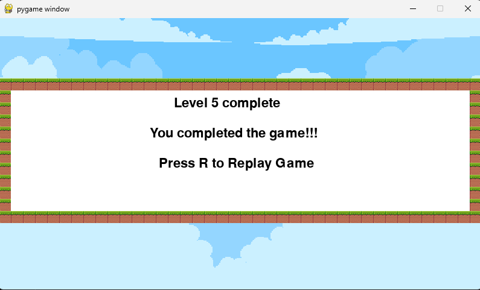

# platformer
It's my forth ever pygame game. It is a platformer game where you navigate through levels with 5 hp. You gain more hp by collecting the apples (they do not respawn after refeating levels). It's a pretty difficulty and ragebaiting game.

AND YES ALL THE LEVELS CAN BE COMPLETED(TESTED BY ME)!!!!

AI USAGE:
>Google overview for syntaxes and such
>Used a bit of ai and stack overflow to learn map making mechanism
>Debugs sometimes and help using pygbag (Made the problem worse so i had to brainstorm myself)

Screenshots:
After you start the game you're greeted with this 

You play it like any other platformer and finish level , you're then greeted with this:

If you lose all 5 of your hp in the process, this screen pops up:

If you complete all 5 levels you finish the game and get this pop up:

WHY I MADE THIS:
>I just wanted to learn pygame and thought platformers might be the perfecet next step in my journey

HOW TO ACCESS:
>Just go to https://shimes.itch.io/platformer

Tools used:
>Pygame python for making game
>pygbag for packaging the game

PROBLEM FACED:
>pygbag not working and havingto change a lot of things to make it work

pygbag was used to make the game playable in itch io so there are unneccessary files present here which can be ignored.

Assets used:
https://pixelfrog-assets.itch.io/pixel-adventure-1 = Main character, blocks and items
https://anokolisa.itch.io/basic-140-tiles-grassland-and-mines = Background
https://xxashuraxx.itch.io/heart = Heart